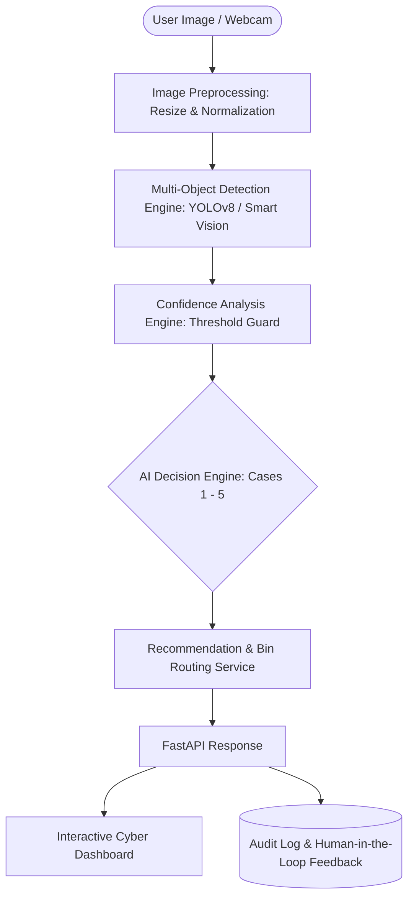

# 🌱 FoodWaste AI – Intelligent Multi-Object Waste Segregation

[](https://github.com/Chiranjeeb1101/foodwaste-ai/actions)
[](https://www.python.org/)
[](https://fastapi.tiangolo.com/)
[](https://opensource.org/licenses/MIT)
[]()

> **India / Odisha Context Edition** – Multi-object waste understanding & decision-support system built for high-impact hackathon presentation.

---

## 🎯 The Problem & Our Novelty

Most waste management AI projects perform **naive single-label image classification** (labeling an entire image as simply *"Plastic"* or *"Organic"*). In the real world—especially across Indian households, college canteens, street food stalls, and community dumpsters—waste is **almost always mixed, overlapping, and dirty**.

### 🌟 Core Contributions & Standout Hackathon Features
1. **C1. Multi-Object Detection:** Isolates and localizes multiple overlapping objects per scene with bounding boxes and per-item confidence scores.
2. **C2. Odisha / India Specific Taxonomy:** Grounded in regional reality (cooked rice, banana peels, coconut shells, PET water bottles, snack wrappers, plastic pouches).
3. **C3. AI Decision Engine:** Synthesizes raw visual detections into **actionable human segregation guidance** rather than blind class tags.
4. **🌿 Environmental ESG & Carbon Impact Engine:** Calculates real-time **kg CO₂e emissions prevented**, **liters of water conserved**, and **landfill diversion score**.
5. **🗣️ Grassroots Vernacular & Voice Narration (EN / हिंदी / ଓଡ଼ିଆ):** Accessibility voice guidance for citizens and sanitation workers in local state languages.
6. **🤖 Virtual Smart Bin IoT Digital Twin (Phase 2 Simulator):** Visualizes motorized servo flaps and ultrasonic fill levels, proving edge hardware readiness without violating software-only Phase 1 rules.
7. **🔄 Continuous Webcam Scanner:** Real-time live video radar tracking items continuously every 1.5 seconds.

---

## 🏗️ System Architecture



---

## 🧠 AI Decision Engine: 5 Core Cases

| Case | Scenario | Logic | System Action / Output |
| :--- | :--- | :--- | :--- |
| **Case 1** | Single Object | Count = 1, Conf $\ge$ Threshold | Directly route to predicted bin (`Dispose as organic waste`) |
| **Case 2** | Multi-Object Homogeneous | Count > 1, All categories identical | Route together (`All items are Recyclable. Dispose together`) |
| **Case 3** | Multi-Object Heterogeneous | Count > 1, Divergent categories | **⚠️ MIXED WASTE DETECTED:** Alert user and list itemized separation steps before binning |
| **Case 4** | Low Confidence | Conf < 0.60 or scene is dim/crushed | **❓ UNCERTAIN:** Prevent false auto-sorting, flag for manual verification |
| **Case 5** | Unknown / Out-of-List | Object not in known taxonomy | **📦 SPECIAL HANDLING:** Tag as `Other`, trigger specialized hazardous/manual handling |

---

## 🚀 Quick Start (Hackathon Demo)

### 1. Launch the Server
Double-click `run.bat` or run in your terminal:
```bash
python run.py
```

### 2. Open the Interactive Dashboard
Navigate to:
```text
http://localhost:8000
```

### 3. Interactive API Documentation (Swagger / OpenAPI)
```text
http://localhost:8000/docs
```

### 4. Or Run via Terminal CLI (Instant Evaluation)
```bash
# Evaluate benchmark cases directly in PowerShell or Bash
python demo_cli.py --preset case3
python demo_cli.py --preset odisha_canteen
python demo_cli.py --image path/to/your/image.jpg
```

---

## 🧪 Hackathon Demo Cheat Sheet (For Judges)

The dashboard includes a dedicated **Benchmark Toolbar** with one-click test cases:

1. **Click `🍌 Case 1: Single Object`** 
   * *Pitch Point:* Shows high-confidence single stream recognition and direct green bin routing.
2. **Click `🧴 Case 2: Multi-Same`** 
   * *Pitch Point:* Proves the model detects multiple distinct objects (PET bottle + wrapper) and recognizes they share a unified recycling stream.
3. **Click `⚠️ Case 3: Mixed Waste` (Crucial)**
   * *Pitch Point:* Shows the flashing siren alert! Demonstrates why standard classifiers fail and how FoodWaste AI instructs the user to separate organic scraps from recyclables before disposal.
4. **Click `❓ Case 4: Low Confidence`**
   * *Pitch Point:* Shows AI safety guardrails. When waste is crushed or lighting is poor, it refuses to guess blindly and routes to manual check.
5. **Click `🍛 Odisha Canteen Thali`**
   * *Pitch Point:* Demonstrates regional domain adaptation on composite food scraps, plastic sachets, and water bottles.
6. **Live Camera Snap:**
   * Switch to the **Live Camera** tab, point your webcam at any real item on your desk, and click **📸 Snap & Analyze**.

---

## 📂 Project Structure

```text
foodwaste_ai/
├── app/
│   ├── main.py                  # FastAPI Application Entrypoint
│   ├── config/
│   │   └── settings.py          # Category taxonomy & thresholds
│   ├── schemas/
│   │   ├── prediction_schema.py # Pydantic response models
│   │   └── decision_schema.py   # Standalone decision schemas
│   ├── engines/
│   │   ├── detection_engine.py  # Multi-object YOLO & smart fallback
│   │   ├── confidence_engine.py # Confidence & uncertainty evaluator
│   │   └── decision_engine.py   # 5-Case segregation rule engine
│   ├── services/
│   │   ├── image_service.py     # Preprocessing, thumbnailing & validation
│   │   ├── prediction_service.py# End-to-end 12-step pipeline orchestrator
│   │   └── recommendation_service.py # Bin color codes & handling tips
│   ├── api/
│   │   ├── prediction_api.py    # POST /predict, POST /feedback, GET /history
│   │   └── decision_api.py      # POST /decision
│   ├── models/
│   │   └── waste_detector/      # Drop custom best.pt weights here
│   └── static/                  # Embedded Web Dashboard
│       ├── index.html           # Glassmorphic UI
│       ├── style.css            # Responsive dark mode styling
│       ├── app.js               # Canvas visualizer & camera controller
│       └── samples/             # 6 high-res benchmark images
├── tests/
│   └── test_foodwaste_ai.py     # Automated pytest suite (7 passing tests)
├── run.py                       # Python launcher
├── run.bat                      # Windows 1-click batch launcher
└── README.md
```

---

## 🔌 API Reference

### 1. `POST /predict`
Analyzes an uploaded image or benchmark preset.
* **Input:** `multipart/form-data` with `image` (file) or `preset_mode` (string).
* **Output:**
```json
{
  "status": "Mixed Waste",
  "objects_detected": 3,
  "categories": ["Organic", "Recyclable", "Glass"],
  "objects": [
    {"object": "banana_peel", "category": "Organic", "confidence": 0.96, "bbox": [51, 72, 268, 312]},
    {"object": "plastic_wrapper", "category": "Recyclable", "confidence": 0.94, "bbox": [307, 57, 563, 264]},
    {"object": "glass_bottle", "category": "Glass", "confidence": 0.97, "bbox": [160, 249, 480, 441]}
  ],
  "recommendation": "Separate organic, recyclable and glass waste before disposal.",
  "bin_guidance": [
    {"category": "Organic", "bin_name": "Green Bin", "color": "#2ecc71"},
    {"category": "Recyclable", "bin_name": "Blue Bin", "color": "#3498db"},
    {"category": "Glass", "bin_name": "Teal / Glass Bin", "color": "#1abc9c"}
  ],
  "annotated_image": "data:image/jpeg;base64,..."
}
```

### 2. `POST /decision`
Run the Decision Engine independently on raw object predictions.
* **Input:**
```json
{
  "objects": [
    {"object": "banana_peel", "category": "Organic", "confidence": 0.96},
    {"object": "plastic_wrapper", "category": "Recyclable", "confidence": 0.94}
  ]
}
```

---

## 🔮 Future Scope (Phase 2)
As specified in the project requirements, **Phase 1 is strictly software-based (No IoT dependencies)**.
In Phase 2, the modular architecture allows seamless hardware drop-ins:
* Weight, ultrasonic fill-level, and moisture sensors.
* Stepper motor-driven automatic sorting flaps directed by `POST /decision`.
