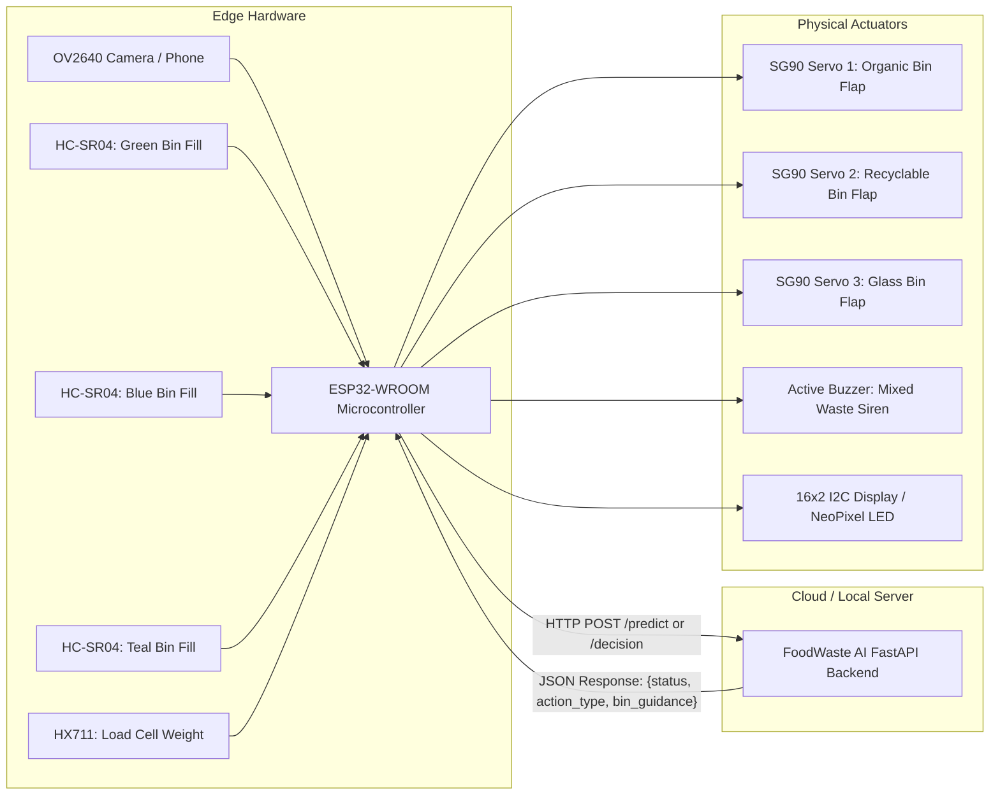

# 🤖 FoodWaste AI – Phase 2 IoT Hardware Architecture & Pinout

> **Strict Phase 1 Compliance:** The core project is 100% software-based. This document and sample firmware define the seamless **Phase 2 Edge Hardware Extension**.

---

## 🔌 System Schematic Overview

---

## 📌 GPIO Pin Allocation (ESP32)

| Component | Pin Function | ESP32 GPIO | Description |
| :--- | :--- | :--- | :--- |
| **Servo 1 (Organic)** | PWM Signal | `GPIO 18` | Drives green bin trapdoor (0° locked, 90° open) |
| **Servo 2 (Recyclable)**| PWM Signal | `GPIO 19` | Drives blue bin trapdoor (0° locked, 90° open) |
| **Servo 3 (Glass)** | PWM Signal | `GPIO 23` | Drives teal bin trapdoor (0° locked, 90° open) |
| **Ultrasonic 1** | Trig / Echo | `GPIO 4 / 5` | Green bin capacity monitoring (0-100%) |
| **Ultrasonic 2** | Trig / Echo | `GPIO 12 / 13` | Blue bin capacity monitoring (0-100%) |
| **Ultrasonic 3** | Trig / Echo | `GPIO 14 / 27` | Teal bin capacity monitoring (0-100%) |
| **Active Buzzer** | Digital Out | `GPIO 25` | Alarms when `status == 'Mixed Waste'` |
| **Status LED Ring** | NeoPixel Data| `GPIO 26` | Red = Mixed alert, Green = Segregated pass |
| **I2C LCD Display** | SDA / SCL | `GPIO 21 / 22` | Displays localized text recommendation |

---

## 🔄 Firmware Execution Loop
1. User approaches bin; ultrasonic presence triggers camera capture.
2. ESP32 sends image to `POST /predict` (or streams raw JSON detections to `POST /decision`).
3. If response is **`Mixed Waste`**:
   * ESP32 locks all servo trapdoors (`0°`).
   * Buzzer sounds double beep.
   * LCD displays: *"Mixed Waste: Separate First"*.
4. If response is **`Single Waste (Organic)`**:
   * Servo 1 opens to `90°` for 5 seconds, then safely resets.
